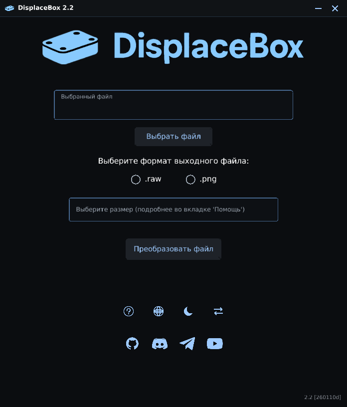
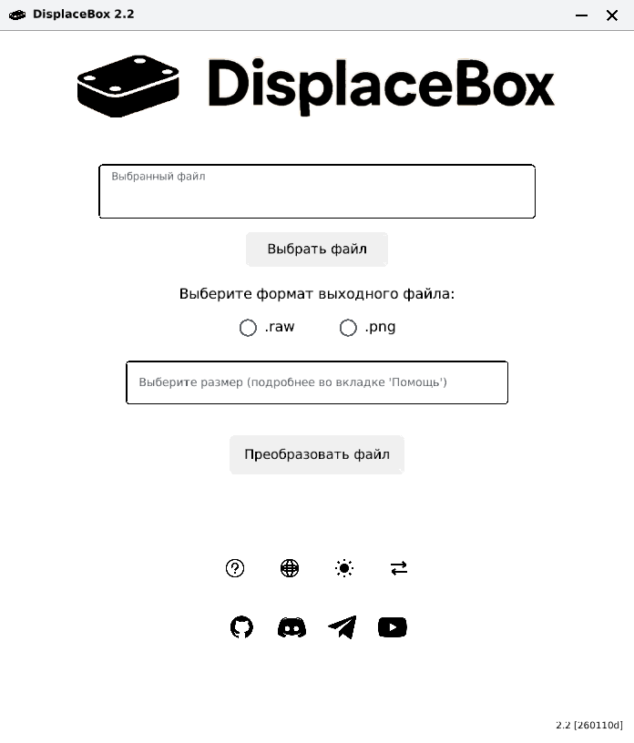
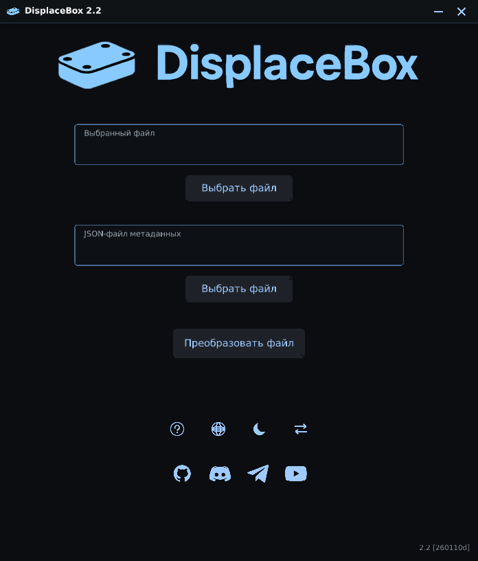
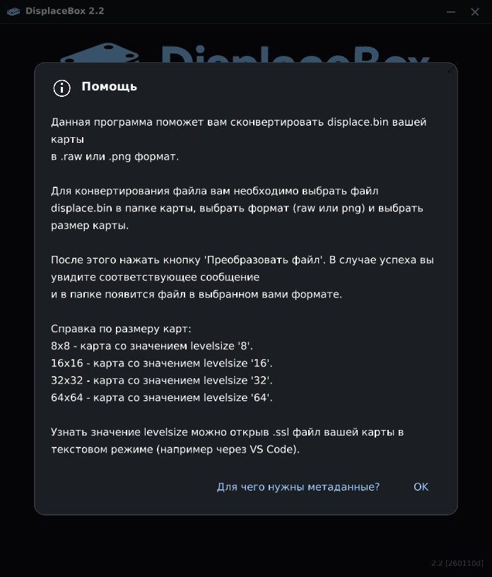

# DisplaceBox — порт на C / raylib (Linux + Windows)

Переписанная на C версия [DisplaceBox](https://github.com/stakanyash/displacebin_gui_converter) 2.2
(оригинал — Python + Flet). Интерфейс и вся логика конвертации воспроизведены
на raylib + raygui; сторонних GUI-библиотек (GTK/Qt/Flet) не требуется.

Поддерживаются **Linux** и **Windows** (MinGW-w64).



## Возможности

- Конвертация `displace.bin` → `.raw` / `.png` (16-битный grayscale PNG).
- Обратная конвертация `.raw` / `.png` → `.bin` с проверкой JSON-метаданных.
- Сохранение метаданных `displace_<имя_папки>_metadata.json` (Min / Max / Delta / DGCVer).
- Пять языков интерфейса: русский, английский, украинский, белорусский, польский.
- Тёмная и светлая темы.
- SDF-шрифт: текст остаётся чётким при любом масштабе интерфейса.
- Встроенный файловый браузер (без системных диалогов).
- UTF-8/Unicode-пути: `C:\Users\Иван\Карты\displace.bin` открывается корректно.
- Логи в файл `dgc_ГГГГ-ММ-ДД_ЧЧ-ММ-СС.log` в рабочей папке.
- Масштаб интерфейса задаётся в `src/app.h` (`UI_SCALE`, сейчас 1.20).

### Сборка на Windows (MinGW-w64 / MSYS2)

Нужны `gcc`, `make`/`mingw32-make` и исходники raylib 6.2 в `../raylib-6.2`.

```bat
build_windows.bat
```

или вручную:

```bat
mingw32-make -f Makefile.win
```

Если `../raylib-6.2/src/libraylib.a` ещё нет, `Makefile.win` соберёт raylib
сам. Результат — `displacebox.exe` в корне проекта; `mingw32-make -f
Makefile.win dist` дополнительно соберёт `dist/windows/`.

### Кросс-сборка из Linux

Нужен `x86_64-w64-mingw32-gcc` (и `windres`):

```bash
./build_windows.sh
```

Скрипт собирает raylib в `build-win/`, затем приложение, и кладёт результат в
`dist/windows/displacebox.exe` вместе с `assets/`.

## Linux: сборка

Нужны компилятор C, make и заголовки OpenGL/X11 (prebuilt-raylib из комплекта
собран под X11/GLX; в Wayland-сессии он работает через XWayland). zlib больше
не требуется — PNG-кодек использует `sdefl`/`sinfl` из raylib.

Debian/Ubuntu:

```bash
sudo apt install build-essential libgl1-mesa-dev libx11-dev
```

Fedora / RedOS:

```bash
sudo dnf install gcc make mesa-libGL-devel libX11-devel
```

Сборка:

```bash
make -j"$(nproc)"
./displacebox
```

По умолчанию Makefile ожидает raylib в `../raylib-6.2_linux_amd64`. Другой путь:

```bash
make RAYLIB_DIR=/path/to/raylib-6.2_linux_amd64
```

Используется статическая `libraylib.a`: приложенная в комплекте `libraylib.so`
собрана под glibc 2.38 и не подходит для систем со старой glibc.

### Запуск

```bash
./displacebox                 # автоопределение языка системы
./displacebox -lang Ru        # принудительно русский
./displacebox -reverse        # сразу режим ".raw/.png → .bin"
./displacebox --light         # светлая тема
```

Клавиши и кнопки:

- `F12` — сохранить скриншот окна в `displacebox_screenshot.png`.
- Кнопка со стрелками переключает направление конвертации.
- Иконка глобуса — выбор языка, иконка луны/солнца — тема.

## Скриншоты

| Тёмная тема | Светлая тема |
|---|---|
|  |  |

| Обратный режим | Справка |
|---|---|
|  |  |

## Как это работает

Прямая конвертация:

1. Читается весь `displace.bin`; ожидаемый размер — `size² × 4` байт
   (float32 little-endian).
2. Значения нормализуются: `(v - min) / (max - min) * 65535`.
3. Результат пишется как `.raw` (uint16 LE) или `.png` (16-bit grayscale).
4. Рядом сохраняется JSON с `Min`, `Max`, `Delta` и `DGCVer`.

Обратная конвертация:

1. Читается `.raw` (uint16 LE) или `.png` (строго 16-bit grayscale).
2. Проверяется JSON (`Min`, `Max`, `Delta`, `DGCVer`), версия метаданных
   сравнивается с текущей (для старых/новых файлов выводится подтверждение).
3. Значения восстанавливаются: `value / 65535 * Delta + Min` и пишутся как
   float32 LE в `.bin`.

Результаты побайтово совпадают с оригинальной Python-реализацией — это
проверяется тестом.

## Архитектура и платформенный слой

```
main.c          — состояние App, экраны, диалоги, ввод, перетаскивание окна
ui.c / ui.h     — темы, шрифты, виджеты, иконки, перенос/обрезка текста
file_dialog.c   — встроенный файловый браузер
converter.c     — прямая/обратная конвертация, JSON-метаданные
png_io.c        — чтение/запись 16-битного grayscale PNG
zlib_codec.c    — zlib-совместимый поток на sdefl/sinfl (без внешнего zlib)
i18n.c          — 5 языков (сгенерирован из оригинала)
platform_common.c / platform_posix.c / platform_win32.c
                — пути, логи, локаль, файлы, каталоги, xdg-open/ShellExecute
raygui_impl.c   — реализация raygui
```

Ключевые решения для кроссплатформенности:

- Внутри приложения все пути — **UTF-8**. На Windows они конвертируются в
  UTF-16 на границе Win32 (`_wfopen`, `FindFirstFileW`, `GetFileAttributesW`,
  `GetFullPathNameW`, `ShellExecuteW`).
- Каталоги абстрагированы через `plat_dir_open/next/close`: POSIX использует
  `dirent`, Windows — `FindFirstFileW`.
- `plat_fopen` скрывает разницу между `fopen` и `_wfopen`.
- Для длинных путей Windows добавляется префикс `\\?\`, в манифесте включён
  `longPathAware`.
- Имена файлов и пути отображаются с родным разделителем (`/` или `\`).
- Своя реализация zlib-потока (`sdefl`/`sinfl` из raylib) убирает зависимость
  от системного zlib — одинаково собирается и на Linux, и на MinGW.
- Текст рисуется SDF-шрифтом (`FONT_SDF` + `sdf.fs` из raylib); для raygui
  используется отдельный обычный шрифт, чтобы шейдер не влиял на контролы.
- Проверка обновлений удалена: приложение не ходит в сеть.

## Масштаб

Макет спроектирован в виртуальной сетке 580×680 и масштабируется камерой
raylib. Коэффициент задаётся в `src/app.h`:

```c
#define UI_SCALE 1.20f
```

При изменении пересоберите проект. Окно будет `580×680 × UI_SCALE`
(при 1.20 — 696×816), координаты мыши пересчитываются автоматически.

## Wayland

В комплекте для Linux идёт raylib 6.2, собранный только с X11-бэкендом GLFW.
В Wayland-сессии (GNOME, KDE) приложение запускается через **XWayland** — он
включён по умолчанию. Перетаскивание окна за заголовок работает.

Если `DISPLAY` не задан (чистый Wayland без XWayland), приложение не падает, а
завершается с понятным сообщением. Для нативного Wayland нужна пересборка
raylib с Wayland-бэкендом.

## Логи и ресурсы

- Лог: `dgc_<дата>_<время>.log` в рабочей папке.
- Ресурсы ищутся в `assets/` рядом с исполняемым файлом (также проверяются
  `../assets`, `../../assets` и переменная окружения `DISPLACEBOX_ASSETS`).
- Шрифт — DejaVu Sans (кириллица + польские диакритики), лицензия в
  `assets/DejaVu-LICENSE.txt`.
- Windows-иконка и манифест лежат в `resources/`, встраиваются через `windres`.

## Тесты

```bash
make test
```

Тест сравнивает C-движок с оригинальной Python-реализацией: `displace.bin`
генерируется детерминированно, затем сравниваются `.raw` (побайтово), `.png`
(попиксельно), JSON-метаданные и обратная конвертация `.bin` (побайтово).
Дополнительно проверяются ошибочные случаи: неверный размер `.bin`, нечётный
`.raw`, 8-битный PNG, нулевые/неполные метаданные.

Для теста нужны Python 3, Pillow и исходники оригинала в
`../displacebin_gui_converter-main`; если их нет — тест пропускается.

## Структура

```
displacebox-c/
├── Makefile                 # Linux
├── Makefile.win             # Windows (MinGW)
├── build_windows.bat        # сборка на Windows
├── build_windows.sh         # кросс-сборка из Linux
├── assets/                  # логотипы, иконки, шрифты
├── resources/               # Windows icon + manifest + .rc
├── docs/screenshots/        # скриншоты для README
├── dist/windows/            # готовый exe + assets
├── src/
│   ├── main.c               # окно, экраны, диалоги, события
│   ├── ui.c / ui.h          # тема, шрифты, виджеты, иконки
│   ├── file_dialog.c        # файловый браузер
│   ├── converter.c          # конвертация, JSON
│   ├── png_io.c             # 16-битный grayscale PNG
│   ├── zlib_codec.c         # sdefl/sinfl
│   ├── platform_common.c    # общий слой
│   ├── platform_posix.c     # Linux
│   ├── platform_win32.c     # Windows
│   ├── entry_win32.c        # WinMain + Unicode argv
│   ├── i18n.c               # переводы
│   ├── raygui_impl.c        # реализация raygui
│   └── external/            # sdefl, sinfl, raygui
├── tests/                   # сравнение с Python-реализацией
└── tools/gen_i18n.py        # генератор i18n.c
```

## Отличия от оригинала

- Нет Python/Flet: полностью нативный C + raylib/raygui.
- Вместо системного файлового диалога Flet — собственный браузер с фильтрами,
  навигацией и вводом пути.
- Автообновление убрано: приложение не проверяет релизы и не ходит в сеть.
- Окно без системных декораций, с собственной строкой заголовка.
- Проверка минимального разрешения — предупреждение в логе, а не выход.

## Ограничения

- Windows-версия собрана и слинкована кросс-компилятором; запуск проверялся на
  Linux-версии, а exe нужно проверить на реальной Windows.
- Окно фиксированного размера; при 1.20 занимает 696×816.
- PNG — только неинтерлейсенный 16-bit grayscale.
- Нет автообновления.
- Язык и тема не сохраняются между запусками.

## Лицензия и авторы

Проект распространяется по лицензии MIT (см. `LICENSE`), как и оригинал.

- **Автор программы**: stakan
- **Автор скрипта конвертации**: [ThePlain](https://github.com/ThePlain)
- **Порт на C/raylib**: данная реализация

Оригинал: https://github.com/stakanyash/displacebin_gui_converter

Шрифт DejaVu Sans распространяется по собственной свободной лицензии
(`assets/DejaVu-LICENSE.txt`).
